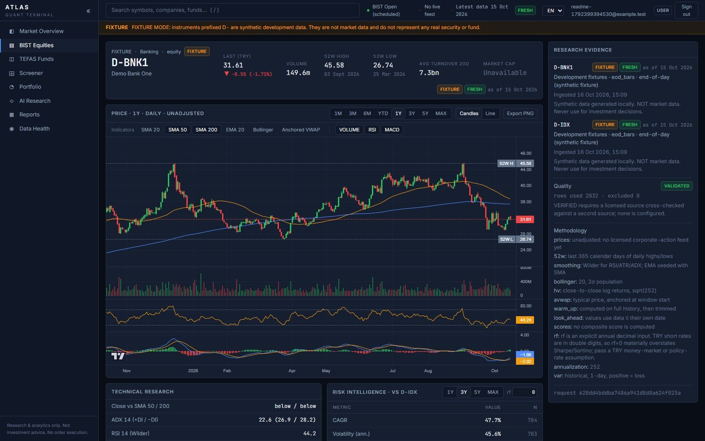
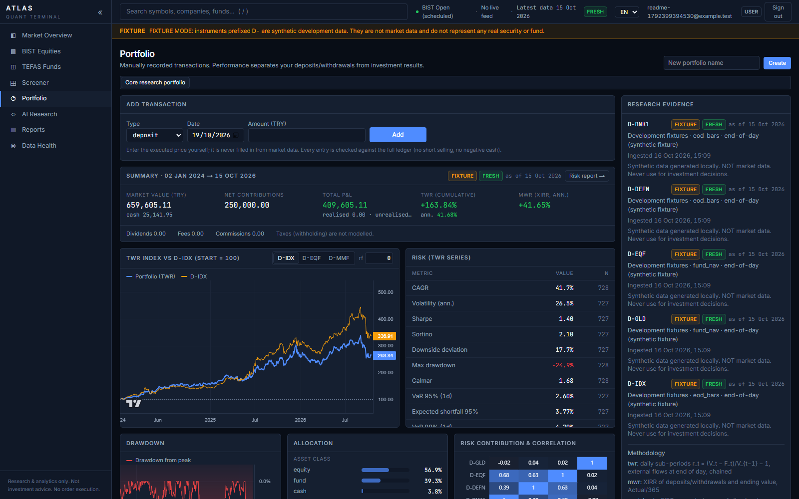
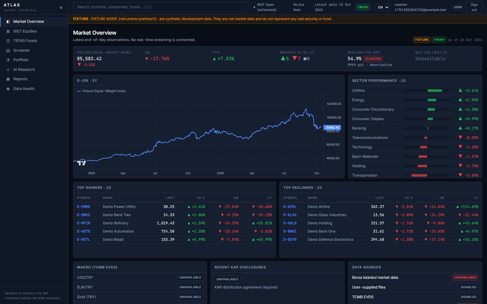
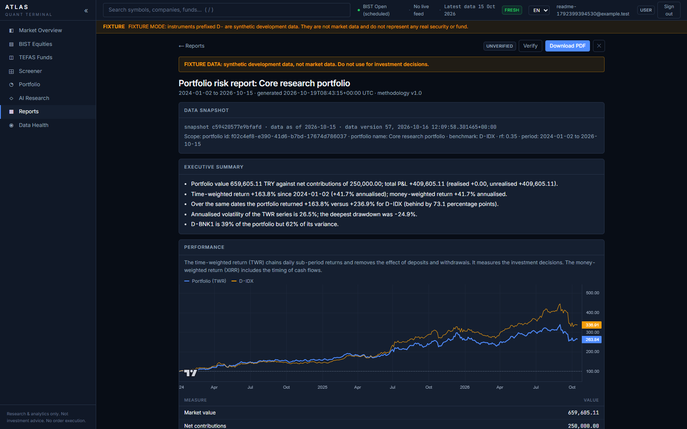
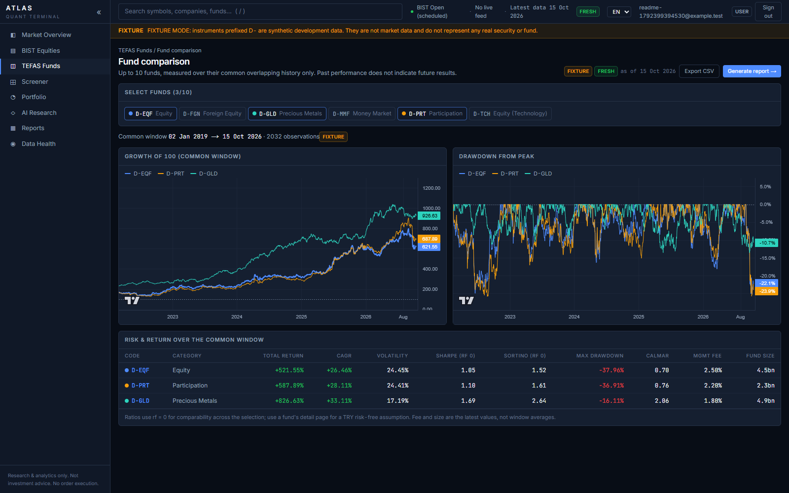
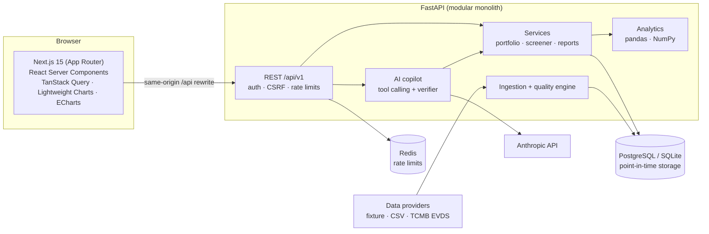

# ATLAS Quant Terminal

A full-stack research and analytics terminal for Turkish markets (BIST equities and TEFAS mutual funds):
technical and risk analytics, portfolio accounting, multi-condition screeners, reproducible PDF reports, and an
LLM research assistant whose numbers are checked against their sources by a deterministic verifier.

**Python · FastAPI · SQLAlchemy · PostgreSQL · Redis · Next.js 15 · TypeScript · Tailwind · Playwright · Docker**

> **Research use only. Not investment advice. No order execution.**
> All market data in this repository is **synthetic fixture data** (symbols `D-…`), generated locally and labelled
> as such on every screen and API response. Licensed BIST/TEFAS feeds plug in through the provider interface.



| | |
|---|---|
|  |  |
| **Portfolio:** ledger-validated transactions, time-weighted and money-weighted returns, benchmark, risk contribution | **Market overview:** index, breadth, sector moves, movers, data-source status |
|  |  |
| **Reports:** stored, reproducible documents with PDF export and a one-click "re-run and compare" check | **Funds:** comparison on a common window, rankings with eligibility rules, CSV export |

## Features

- **Equity and fund research:** candlestick charts with SMA/EMA/Bollinger/VWAP, RSI, MACD, ADX; 52-week ranges;
  risk metrics (CAGR, volatility, Sharpe, Sortino, max drawdown, VaR/ES, beta, capture ratios) against a benchmark.
- **Portfolio analytics:** transactions validated against the full ledger (no short selling or negative cash),
  FIFO realised/unrealised P&L, daily time-weighted return, XIRR, drawdown, correlation and risk contribution.
- **Screeners:** nested AND/OR conditions over a typed field catalogue, point-in-time `as_of` evaluation,
  missing-data diagnostics, saved screens, server-side sorting and CSV export.
- **Reports:** portfolio risk and fund comparison reports stored as structured documents; PDF rendering;
  `verify` regenerates a report from its stored inputs and diffs every figure.
- **AI research assistant:** Claude with 13 typed, read-only tools. Every figure in an answer must cite an
  evidence item, and a deterministic checker flags any number that is not present in the cited tool output.
- **Data quality:** every row carries source, as-of date and a quality status; a data-health dashboard shows
  freshness, failed ingestions and open quality issues.
- **Production hardening:** session auth with CSRF protection and RBAC, Redis-backed rate limiting, login
  lockout, security headers and CSP, Prometheus metrics, readiness checks, and verified backup/restore.

## Architecture



Architecture notes and decisions: [docs/architecture](docs/architecture).
Endpoints: [docs/api/API.md](docs/api/API.md) and the generated [OpenAPI contract](packages/shared-types/openapi.json).

## Engineering highlights

| Problem | Approach | Where |
|---|---|---|
| LLMs invent numbers | The model may only call deterministic tools; each figure must cite `[E#]`; a parser checks every number (units, %, magnitudes, Turkish/English formats) against the cited evidence | [`app/ai/verify.py`](apps/api/app/ai/verify.py), [AI_COPILOT.md](docs/financial-methodology/AI_COPILOT.md) |
| Deposits distort portfolio returns | Daily time-weighted return with flows applied at end of day, plus XIRR for the investor's own timing | [`analytics/portfolio.py`](apps/api/app/analytics/portfolio.py), [PORTFOLIO.md](docs/financial-methodology/PORTFOLIO.md) |
| Look-ahead bias in research | Indicators and screens use only data known at their date; dedicated no-look-ahead tests | [`tests/test_no_lookahead.py`](apps/api/tests/test_no_lookahead.py) |
| Metric correctness | Reference values computed by hand plus Hypothesis property tests (e.g. beta of a levered path equals the leverage) | [`tests/test_metrics_*`](apps/api/tests) |
| Reports that cannot be reproduced | Reports store their inputs and data snapshot; `verify` regenerates and diffs every fact | [REPORTS.md](docs/financial-methodology/REPORTS.md) |
| Shared IP behind a proxy | Client IP from `X-Forwarded-For` only via trusted proxies, read right to left | [`core/observability.py`](apps/api/app/core/observability.py) |
| Slow page transitions | Measured: a route-level loading skeleton made React hold every page for ~300 ms; removed in favour of a delayed link indicator (25–200 ms per navigation) | [RUNBOOK.md](docs/operations/RUNBOOK.md) |

## Quality

| Suite | Result |
|---|---|
| Backend: pytest (reference values, property tests, API, auth, isolation, migrations, AI verifier, backups) | 193 passed |
| Frontend: Vitest + Testing Library, TypeScript strict | 24 passed, clean |
| End to end: Playwright against a production build | 9 passed |
| Dependency audit: `pip-audit` | no known vulnerabilities |

CI ([`.github/workflows/ci.yml`](.github/workflows/ci.yml)) runs the backend tests, migrations against a real
PostgreSQL, the frontend checks and build, and the Playwright suite on every push.
Internal security review: [SECURITY_REVIEW.md](docs/compliance/SECURITY_REVIEW.md).

## Run locally

Requirements: Python 3.12, Node.js 22.

```bash
cd apps/api
python -m venv .venv && source .venv/bin/activate   # Windows: .venv\Scripts\activate
pip install -e ".[dev]"
alembic upgrade head && python -m app.workers.cli ingest   # creates the database and loads fixture data
uvicorn app.main:app --port 8000
```

```bash
cd apps/web
npm ci && npm run build && npm start   # http://localhost:3000
```

On Windows, `baslat.cmd` does all of the above in one double-click. Running tests, Docker Compose, backups and
monitoring: [docs/operations/RUNBOOK.md](docs/operations/RUNBOOK.md). The AI assistant needs `ANTHROPIC_API_KEY`
in the API's environment; without it the page explains how to configure it.

## Repository

```
apps/api            FastAPI backend: analytics, services, AI copilot, ingestion, migrations CLI
apps/web            Next.js frontend: App Router, feature modules, Vitest and Playwright tests
infrastructure/     Dockerfiles, Alembic migrations, Prometheus scrape config and alert rules
docs/               architecture, financial methodology, API, security, operations
packages/           generated OpenAPI contract
```

## Status and limitations

- Market data is synthetic; prices are unadjusted (no corporate-action feed); exchange holidays are not modelled.
- Docker Compose, Redis and Prometheus configurations are written and unit-tested but have not yet been run as a
  full stack.
- Detailed status and roadmap: [docs/STATUS.md](docs/STATUS.md), [docs/ROADMAP.md](docs/ROADMAP.md).

## License

[MIT](LICENSE)
